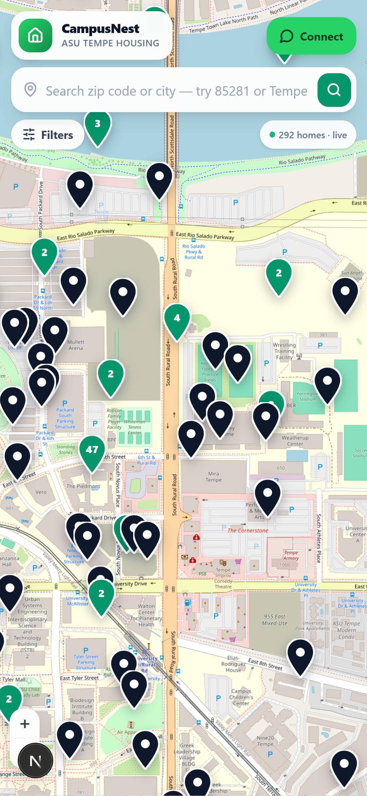
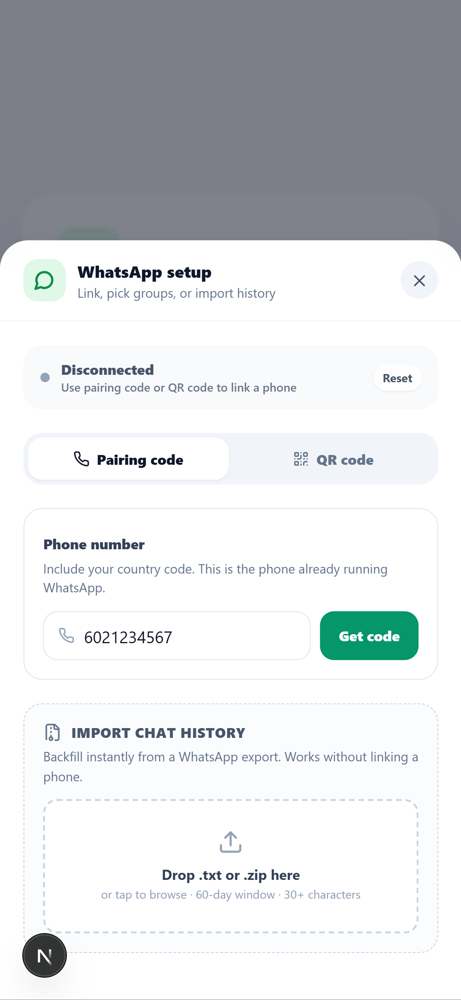
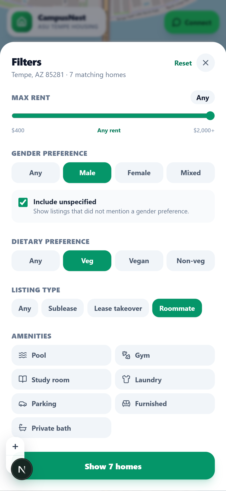
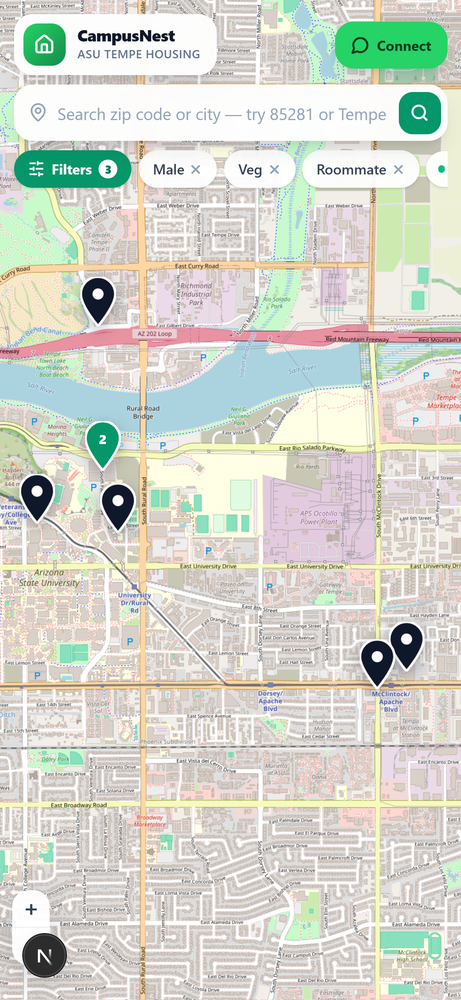
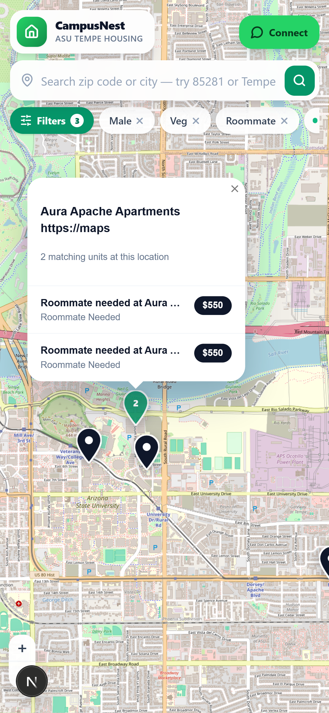
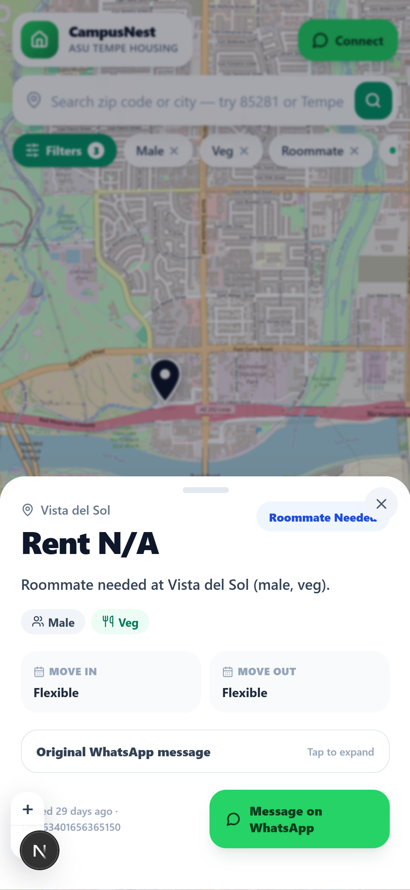

# 🏠 CampusNest

**AI-powered student housing — built from your group chats.**

> Stop scrolling. Start moving in.



---

## The Problem

Every semester, millions of university students search for housing — but the *real* market isn't on Zillow or Apartments.com. It lives inside **WhatsApp and Telegram group chats**: roommate searches, subleases, lease takeovers, short-term swaps, all buried in an endless scroll of messages.

Finding a place means:

- 📜 Scrolling through **hundreds of unread messages** daily
- 🔍 Mentally cross-referencing rent, location, move-in dates, dietary preferences, gender preferences, and pet policies
- ⏱️ Racing to respond before someone else claims it — listings go stale in **minutes**
- 📋 Copy-pasting into spreadsheets and notes apps just to keep track

It's exhausting, error-prone, and brutally time-sensitive. Chat apps were never built to be search engines — but that's exactly how students are forced to use them.

## The Solution

CampusNest **connects to your WhatsApp housing group chats** and uses AI to parse every message in real time — extracting structured listings and plotting them on an **interactive map**.

Think: **Tinder meets Google Maps, but for student housing found inside your existing group chats.**

### How it works

1. **Connect** — Link your WhatsApp via pairing code or QR, or import a chat export. Pick the housing groups you want to track.

   

2. **AI extracts listings** — Every message is parsed in real time. The AI pulls out location, rent, roommate preferences, dietary compatibility, lease type, and dates — turning unstructured chat into structured, searchable data.

3. **See everything on a map** — All extracted listings appear as pins on an interactive map. Clusters show density. A live counter shows how many homes are being tracked.

   

4. **Filter your world** — Set your budget, gender preference, dietary needs, listing type, amenities, and more. Irrelevant pins fade away instantly — 292 listings becomes just the 7 that matter to you.

   <p float="left">
     
     
   </p>

5. **Tap, match, message** — Tap any pin to see the full listing detail: price, preferences, dates, and the original WhatsApp message. One tap to reply directly on WhatsApp.

   <p float="left">
     
     
   </p>

---

## Tech Stack

| Layer | Technology |
|---|---|
| Framework | [Next.js 16](https://nextjs.org/) (React 19) |
| Language | TypeScript |
| WhatsApp | [Baileys](https://github.com/WhiskeySockets/Baileys) (multi-device) |
| Maps | [Leaflet](https://leafletjs.com/) + [React Leaflet](https://react-leaflet.js.org/) |
| Database | [Supabase](https://supabase.com/) |
| Styling | [Tailwind CSS](https://tailwindcss.com/) |
| Validation | [Zod](https://zod.dev/) |
| Testing | [Vitest](https://vitest.dev/) |

## Getting Started

```bash
# Install dependencies
npm install

# Copy environment variables
cp .env.example .env.local
# Fill in your Supabase credentials and any other required keys

# Start the dev server
npm run dev
```

Open [http://localhost:3000](http://localhost:3000) to see the app.

## Scripts

| Command | Description |
|---|---|
| `npm run dev` | Start development server |
| `npm run build` | Production build |
| `npm run start` | Start production server |
| `npm run test` | Run tests (Vitest) |
| `npm run typecheck` | TypeScript type checking |

---

<p align="center">
  Built for students, by students. 🎓
</p>
